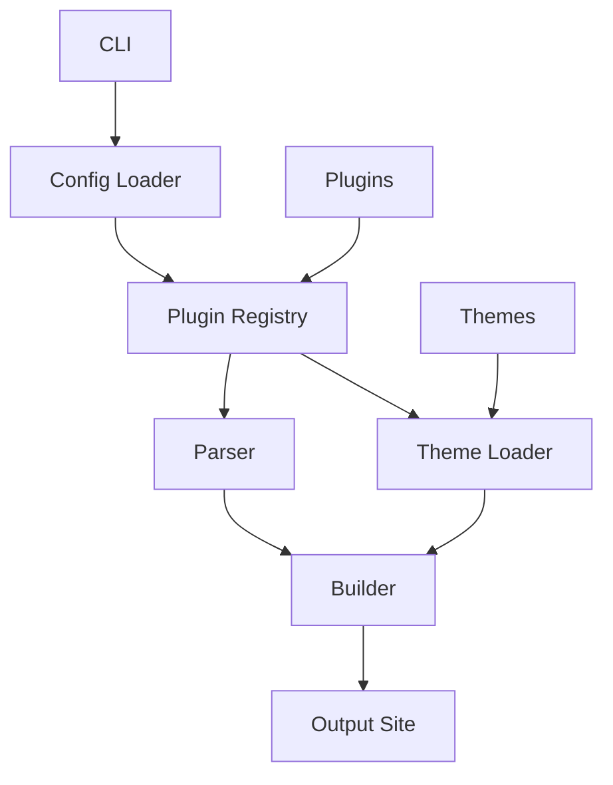

# Docsmaker Package Architecture Design

## Overview

Docsmaker is a modular Python package for generating static documentation sites from Markdown files. It supports theming, plugins, configuration, and CLI operations for building and hosting documentation.

## Core Principles

- **Modularity**: Separate concerns into distinct modules.
- **Extensibility**: Plugin system for custom parsers, themes, and processors.
- **Configuration**: YAML-based config with validation.
- **Theming**: Pluggable themes with templates and assets.
- **CLI**: Command-line interface for build, serve, and other operations.
- **PyPI Packaging**: Proper packaging for distribution.

## Package Structure

```
docsmaker/
├── __init__.py          # Package initialization, version
├── __main__.py          # Entry point for `python -m docsmaker`
├── cli.py               # CLI commands using Typer
├── config.py            # Configuration loading and validation (Pydantic)
├── parser.py            # Markdown parsing with plugins
├── builder.py           # Site building logic
├── utils.py             # Utility functions
├── themes/              # Built-in themes
│   ├── __init__.py
│   ├── default/         # Default theme
│   │   ├── templates/
│   │   │   ├── base.html
│   │   │   ├── sidebar.html
│   │   └── static/
│   │       ├── css/
│   │       └── js/
│   └── custom/          # Example custom theme
├── plugins/             # Plugin system
│   ├── __init__.py      # Plugin registry
│   ├── base.py          # Base plugin classes
│   └── example_plugin.py # Example plugin
├── pyproject.toml       # Packaging and dependencies
└── README.md
```

## Key Components

### Configuration (config.py)

- Uses Pydantic for schema validation.
- Loads from `docs/conf.yaml` or CLI overrides.
- Supports site metadata, navigation, theme selection, plugin configs.

Example config:
```yaml
site_name: "My Docs"
docs_dir: "docs"
out_dir: "site"
theme: "default"
plugins:
  - name: "custom_parser"
    options: {}
navigation:
  - title: Home
    file: index.md
```

### Parser (parser.py)

- Wraps MarkdownIt with plugins.
- Supports custom parsers via plugins.
- Handles front matter, footnotes, tables, etc.
- Generates HTML with anchors, link rewriting.

### Builder (builder.py)

- Orchestrates the build process.
- Collects Markdown files.
- Generates pages, sidebar, TOC, search index.
- Copies assets.
- Supports incremental builds.

### Theming System

- Themes are directories with templates (Jinja2) and static assets.
- Theme class loads templates and renders pages.
- Supports custom themes via plugins or user directories.
- Default theme based on current generate_docs.py styling.

### Plugin System

- Uses entry points for external plugins.
- Registry for parsers, processors, themes.
- Base classes: `ParserPlugin`, `ProcessorPlugin`, `ThemePlugin`.
- Allows extending Markdown parsing, adding processors (e.g., minification), custom themes.

### CLI (cli.py)

- Commands: `build`, `serve`, `init`, `clean`.
- `build`: Generate site.
- `serve`: Start local server with live reload.
- `init`: Create initial docs structure.
- Options for config file, output dir, etc.

### Utils (utils.py)

- File operations, slug generation, HTML processing.
- Reusable functions from original script.

## Workflow

1. Load configuration.
2. Initialize plugins and theme.
3. Parse Markdown files.
4. Build pages with templates.
5. Generate sidebar, TOC, search.
6. Copy assets.
7. Output to build directory.

## Extensibility Features

- **Plugins**: Add custom Markdown extensions, processors.
- **Themes**: Create new themes with custom layouts.
- **Configuration**: Extend config schema for custom options.
- **CLI**: Add new commands via plugins.

## PyPI Packaging

- `pyproject.toml` with dependencies: markdown-it-py, pydantic, typer, jinja2, etc.
- Entry points for CLI and plugins.
- Supports Python 3.8+.

## Handling Complex Projects

- Multiple docs directories.
- Custom navigation structures.
- Plugin-based extensions for advanced features (e.g., API docs generation).
- Support for internationalization.

## Mermaid Diagram: Architecture Overview



## One-Command Generation and Hosting

- `docsmaker build && docsmaker serve` for local development.
- Integrated server with auto-reload.
- Option for production hosting (e.g., via GitHub Pages).

This design transforms the monolithic generate_docs.py into a maintainable, extensible package.